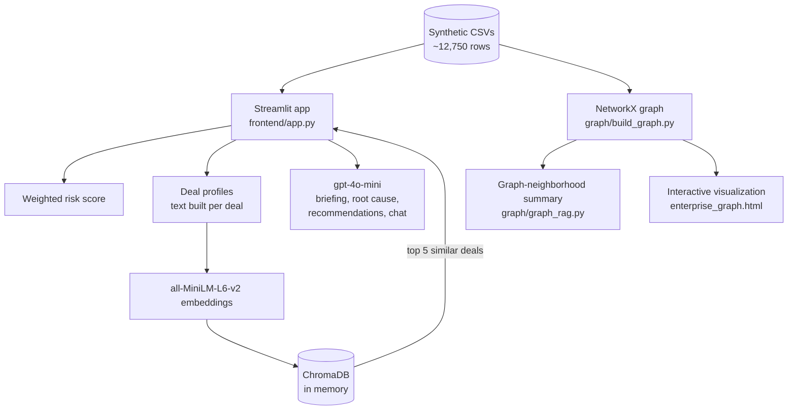

# AI Deal Intelligence Platform

An executive-intelligence prototype that brings customers, deals, tickets, risks, escalations and meeting notes into one place, then adds risk scoring, root-cause analysis, recommendations, semantic search and a chat assistant on top.

> **Status:** prototype on synthetic data. It was the first version of this idea; a more refined, role-based version is in [ai-bi-intelligence-platform](https://github.com/shubhi1907/ai-bi-intelligence-platform).

<!-- TODO: add a 30-60 second demo GIF or screenshot here, e.g.  -->

## The problem

Information about one implementation project is spread across ticket systems, risk logs, escalation threads and meeting notes. Getting an executive-level answer means someone reading all of them. This prototype tests whether connecting those sources and letting a language model summarize them can produce a usable briefing.

## What it does

- **Portfolio risk score.** Ranks deals from 0 to 100 using blockers, delay, tickets, escalations and logged risks.
- **Executive briefing.** Generates a portfolio-level summary of what needs attention.
- **Root-cause analysis and recommendations.** Summarizes likely causes of delivery problems and suggests next actions.
- **Semantic deal search.** Describe a situation in plain language and get the five most similar deals.
- **Chat assistant.** Ask questions about deals, risks and escalations.
- **Knowledge graph (separate scripts).** Models 6 entity types as a graph and includes a graph-neighborhood summary and an interactive visualization.

## How it works



**Graph model.** Nodes: customer, deal, ticket, risk, escalation, meeting (about 7,350 in total). Edges: `HAS_DEAL`, `HAS_TICKET`, `HAS_RISK`, `HAS_ESCALATION`, `HAS_MEETING`. The graph scripts run separately; the Streamlit app does not call them.

## Data

Nine CSV files under `data/` with synthetic customers, deals, tickets, risks, escalations, meeting notes, tasks, status reports and a derived risk table. No real customer or company data is included.

## Run it locally

Run all commands from the repository root, because data paths are relative.

```bash
pip install -r requirements.txt
echo "OPENAI_API_KEY=your-key" > .env        # never commit this file
streamlit run frontend/app.py

# Optional: graph experiments
python graph/build_graph.py
python graph/visualize_graph.py
```

## Design decisions

- **Retrieve first, then generate.** Deal profiles are embedded and searched so the model works from relevant records rather than the whole dataset.
- **Graph for relationships.** A graph makes questions like "what is connected to this deal?" a lookup rather than a join across files.
- **A small, cheap model.** `gpt-4o-mini` keeps the prototype inexpensive to run.

## Known limitations

- The risk weights are hand-picked and not validated against real outcomes.
- The graph is not wired into the Streamlit app. The graph summary script analyzes only the first deal in the data.
- There is no evaluation of answer quality, retrieval hit rate or hallucination rate.
- The vector index is rebuilt in memory on each run.
- No authentication or permissions.
- `graph/graph_rag.py` and the notebook are experiments, not tested components.

## What I would do next

1. Write 30-50 questions with known answers and measure retrieval hit rate in the top 5.
2. Compare answers with and without the graph step to see whether relationships improve accuracy.
3. Wire the graph into the app, with citations to specific records.
4. Check each claim in generated summaries against the retrieved records.

## Tech stack

Python, Streamlit, pandas, ChromaDB, sentence-transformers, NetworkX, OpenAI API.
